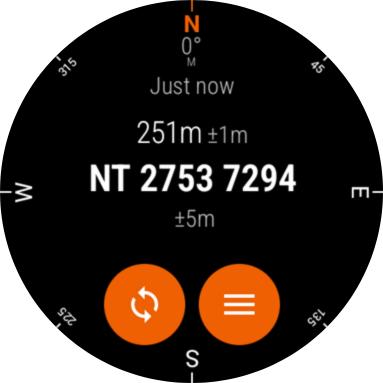
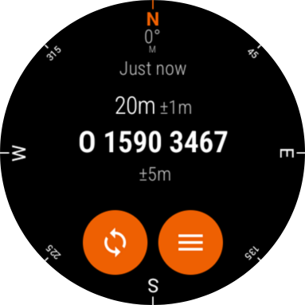
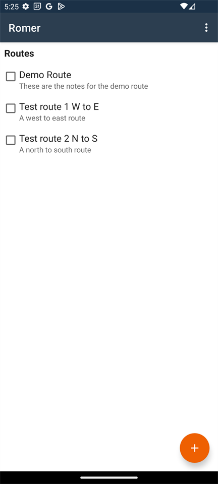
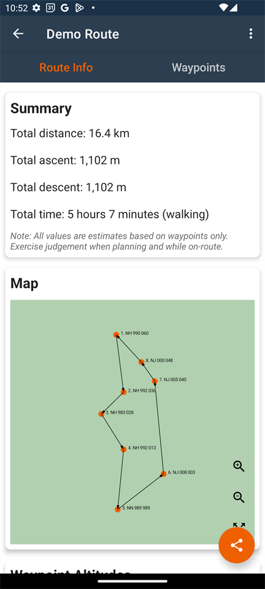
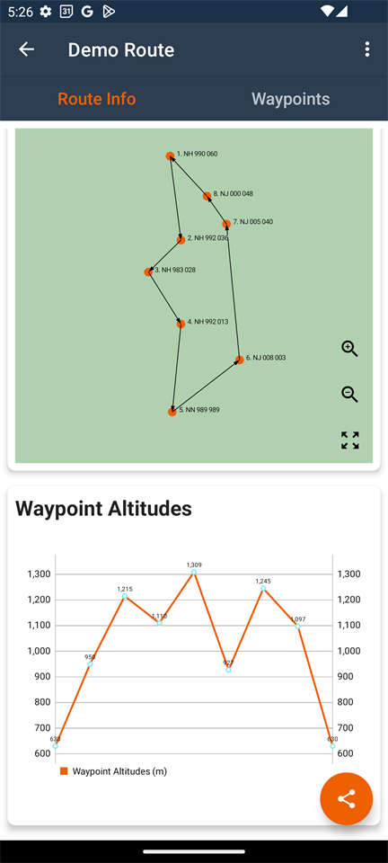

# Romer

Romer is a pair of Wear OS™ and Android™ apps for hill walkers who navigate with a paper map and a compass
It's a Wear OS watch app first, with a companion Android phone app for preparing routes.
It's named after the romer, the small scale that walkers use to read grid references off a paper map.

Romer doesn't replace the map. On the hill, a glance at the watch gives you your position as a grid
reference to find on your map, and a compass to set the map by. It can carry a route of waypoints and
remind you to tick them off as you reach them. At home, the phone app plans and reviews routes,
imports and exports GPX files, and sends routes to the watch.

Android and Wear OS are trademarks of Google LLC. This project is not associated with or
endorsed by Google LLC.

**See the [user guide](docs/user-guide.md)** for how to use it.

> [!CAUTION]
> Romer is free, non-commercial software, provided as is, with no guarantee of fitness for any purpose
> or of reliability. It's intended as an aid to navigation with a paper map, for people who are already
> proficient navigators with a map and compass. Don't use it as your only means of navigation. It
> doesn't replace good judgement: always check the information it gives you against your map, your
> compass and what you can see around you.

Written in C# with .NET 10 for Android.

<p>
  
  
  
</p>
<p>
  
  
  
</p>


## Features

A summary. The [user guide](docs/user-guide.md) describes each feature in detail.

**Watch app**
- Your location as a grid reference on the British National Grid, the Irish Grid, the US National
  Grid, UTM or latitude/longitude, to 1 m, 10 m or 100 m. Only the grids that cover where you are
  are offered.
- Altitude from GPS, falling back to the barometer when a fix has no altitude.
- A compass bezel for setting the map, in several styles, with a magnetic bearing. It dims when the
  compass needs calibrating.
- A route of waypoints. When you're within 50 m of a waypoint, the app offers to mark it as visited.
  Add waypoints at your current location, start a new route, and send the route to the phone.
- Night colours, and settings for location source, fix timeout and units.

**Phone app**
- Create, edit, reverse and delete routes and waypoints.
- Route summary: distance, ascent, descent, and walking time estimated with
  [Naismith's rule](https://en.wikipedia.org/wiki/Naismith%27s_rule).
- Zoomable route map, altitude chart and leg distance chart.
- Import GPX files (waypoints, routes or tracks), and save or share routes as GPX.
- Send routes to the watch over the Wear OS Data Layer.


## Project structure

| Project | Target | Purpose |
| --- | --- | --- |
| `Romer.GeoLib` | `net10.0` | Grid systems (coordinate conversions and the areas they cover), route properties, bearing arithmetic. No Android dependencies. |
| `Romer.DataLib` | `net10.0` | Route and waypoint storage in SQLite. |
| `Romer.CommonLib` | `net10.0-android` | Android code shared by both apps: location and altitude, compass sensor and view, diagnostics, preferences, Wear OS message paths, value formatting. |
| `Romer.Wearable.App` | `net10.0-android` | Wear OS app. |
| `Romer.Mobile.App` | `net10.0-android` | Phone app. |
| `Romer.GeoLib.Tests`, `Romer.DataLib.Tests` | `net10.0` | MSTest unit tests. |

The apps also use [Kilsten](https://github.com/andyjohnson0/Kilsten), my own MIT-licensed library of
Android and Wear OS helpers, controls and dialogs. Version 2.0 is included in `lib/` as prebuilt
assemblies, built from its `main` branch.

Both apps have the same application ID (`uk.andyjohnson.romer`). This is deliberate: the Wear OS
Data Layer only connects phone and watch apps that share a package name and signing key.


## Building

You need the .NET 10 SDK, the Android workload, and an Android SDK with API 36.

```bash
dotnet workload install android
dotnet build Romer.sln
dotnet test Romer.sln
```

To run an app on a device or emulator, use the `Install` target. Debug builds use Fast Deployment,
so an APK installed directly with `adb install` won't start.

```bash
dotnet build Romer.Wearable.App -t:Install
```

The watch app targets Wear OS 3 (API 30) and later, and the phone app Android 11 (API 30) and later.
DEBUG builds have a Debug menu on the phone, and a long press on the watch's refresh button
toggles a demo mode. Both load sample routes.


## Licence

MIT. See [LICENSE.md](LICENSE.md).

Some code and assets that Romer incorporates are under other licences, and stay under them: see
[THIRD-PARTY-NOTICES.md](THIRD-PARTY-NOTICES.md). For example, the Ireland icon is licensed under
CC BY-SA 3.0, not MIT.


## Authors

- Andrew Johnson - [https://andyjohnson.uk](https://andyjohnson.uk)
- Claude, Anthropic's AI model, working through Claude Code - co-author


## AI Statement

Romer was originally written by me (Andrew) in 2022-23. In 2026 it was substantially reworked with
Claude Code, which I credit as a co-author. Claude fixed bugs and crashes, migrated the apps to current
Android and AndroidX APIs, consolidated the code shared by the two apps, moved GPX conversion into a
tested library, improved the layour of map labels, and wrote the user guide. I directed this work.


## Notes

- The grid conversions are adapted from open-source implementations; see
  [THIRD-PARTY-NOTICES.md](THIRD-PARTY-NOTICES.md). Unit tests check them against reference
  grid references, and check that each grid system can format every location it claims.
- Barometric altitude isn't calibrated against local sea-level pressure, so it's used only when a
  GPS fix has no altitude.
- Compass bearings are magnetic, not true.
- This is a personal project and isn't published on Google Play.

