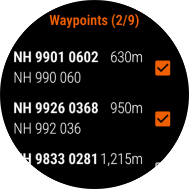

# Romer user guide

> [!CAUTION]
> Romer is free, non-commercial software, provided as is, with no guarantee of fitness for any purpose
> or of reliability. It's intended as an aid to navigation with a paper map, for people who are already
> proficient navigators with a map and compass. Don't use it as your only means of navigation. It
> doesn't replace good judgement: always check the information it gives you against your map, your
> compass and what you can see around you.

Romer is a navigation aid for hill walkers who navigate with a paper map and compass. It runs on a
Wear OS watch, with a companion app for an Android phone.

Romer doesn't try to replace your map. It answers the two questions you ask most often on the hill,
quickly and without getting your phone out:

- **Where am I?** The watch shows your position as a grid reference that you can find on your map,
  using the grid printed on it.
- **Which way is north?** The watch's compass helps you set (orient) the map, so that it lines up
  with the ground around you.

It can also carry a route of waypoints, and remind you to tick each one off as you reach it.

The watch is the main tool, used on the hill. The phone app is for preparing and reviewing routes at
home: creating and editing them, importing and exporting GPX files, and sending them to the watch.

The app is named after the romer, the small scale that walkers use to read grid references off a
paper map.

## Contents

- [What you need](#what-you-need)
- [Key ideas](#key-ideas)
- [A typical day out](#a-typical-day-out)
- [The watch app](#the-watch-app)
  - [The main screen](#the-main-screen)
  - [Getting your location](#getting-your-location)
  - [Choosing a grid](#choosing-a-grid)
  - [Altitude](#altitude)
  - [The compass](#the-compass)
  - [The route](#the-route)
  - [Watch settings](#watch-settings)
- [The phone app](#the-phone-app)
  - [The route list](#the-route-list)
  - [The route screen](#the-route-screen)
  - [Editing waypoints](#editing-waypoints)
  - [Sharing and exporting](#sharing-and-exporting)
  - [Importing GPX files](#importing-gpx-files)
  - [Phone settings](#phone-settings)
- [Accuracy and limitations](#accuracy-and-limitations)
- [Troubleshooting](#troubleshooting)

## What you need

- A Wear OS watch running Wear OS 3 or later. A built-in GPS is best. Without one, the watch uses the
  phone's location. A compass (magnetometer) and a barometer are useful but optional.
- An Android phone running Android 11 or later, paired with the watch, for preparing routes. You can
  use the watch on its own, but routes can only be planned, imported and reviewed on the phone.
- Romer installed on both. The watch app and the phone app find each other automatically when the
  devices are paired.

Romer asks for two permissions. It needs your precise location to show a grid reference. It also asks
to show notifications, which it uses to tell you when a route arrives from the other device. Romer
works without notifications, but you won't be told when a route arrives.

## Key ideas

**Grid reference.** A position on a national map grid, such as `SE 2979 3392` on the British National
Grid. You find it on a paper map by reading the grid lines, eastings first and then northings. Romer
supports several grids, and offers only those that cover where you are.

**Route.** An ordered list of waypoints. The phone can hold any number of routes. The watch holds one
route at a time: the one you're walking.

**Waypoint.** A point on a route, with a name, an optional description, its latitude and longitude,
and an optional elevation. On the watch, waypoints can be ticked off as visited.

## A typical day out

1. **At home, on the phone:** plan the route. Import it as a GPX file from another app or website, or
   build it from waypoints you've recorded with the watch on earlier walks. Check it on the map and
   the summary, which gives the distance, the ascent and descent, and an estimated walking time.
2. **Send the route to the watch.** It replaces whatever route the watch had before.
3. **On the hill, on the watch:**
   - Tap refresh to get a fix, and read the grid reference. Find it on your map.
   - Use the compass to set the map: turn the map until its north lines up with the compass's N.
   - When you're close to a waypoint, the watch offers to tick it off.
   - To record somewhere interesting, add a waypoint at your current location.
4. **Back home:** send the route from the watch to the phone, to keep any waypoints you added.

## The watch app

### The main screen

From the top of the screen down:

- **Compass bezel.** A ring of ticks and labels around the edge, with N, E, S and W, that turns to
  show which way is north. See [The compass](#the-compass).
- **Bearing.** The direction the top of the watch is facing, in degrees, such as `123°`, with an `M`
  below it to show that it's a magnetic bearing.
- **Fix age.** How long ago the location was found, for example "Just now" or "5 minutes ago".
  This updates every minute, so you can tell when a grid reference is getting old.
- **Altitude,** with its accuracy, for example `100m ±1m`.
- **Grid reference,** in large text, with the location's accuracy below it, for example `±5m`.
- **Refresh button** (left). Gets a new location fix.
- **Menu button** (right). Opens the route and settings buttons.

### Getting your location

Tap the **refresh button** to get a fix. A progress screen shows while the watch waits for the GPS.
After a few seconds you can cancel it with the cancel button, or with the watch's back gesture.

To save battery, Romer doesn't track your location continuously. It gets one fix each time you ask.
If you'd like a fix as soon as the app opens, turn on **Startup** in the advanced settings.

- **GPS turned off.** If the location source is **Built-in GPS** and location is off on the watch,
  Romer offers to open the watch's settings so that you can turn it on. When you come back, it tries
  again.
- **Timeout.** If there's no fix within the GPS fix timeout (30 seconds by default), Romer says so.
  A clear view of the sky helps. You can make the timeout longer in the advanced settings.
- **Screen.** While waiting for a fix, the screen stays on by default, so that the watch doesn't go
  to sleep before the fix arrives. You can turn this off in the advanced settings.
- **Location source.** By default, Romer uses the paired phone's location when the phone is
  connected, which saves the watch's battery, and the watch's built-in GPS when it isn't. To always
  use the watch's GPS, set **Location Source** to **Built-in GPS**. If your watch has no GPS, Romer
  always uses the phone.

The first time, Romer asks for permission to use your precise location. If you decline, it explains
why it needs it. If you decline permanently, it offers to open the app's settings so that you can
allow it there.

### Choosing a grid

After the first fix each time the app starts, Romer asks which grid to use. It lists only the grids
that cover your location:

| Grid | Where |
| --- | --- |
| British National Grid | Great Britain. Grid references with the Ordnance Survey's two-letter square names, such as `SE 2979 3392`. |
| Irish Grid | Ireland and Northern Ireland. |
| US National Grid | The United States. |
| Universal Transverse Mercator (UTM) | Most of the world. |
| Latitude/Longitude (WGS84) | Everywhere, in decimal degrees. |

Choose the grid that's printed on your map. To change it, tap the grid reference. If you leave the
list without choosing, the watch shows **Choose a grid**. Tap it to open the list again.

If you move outside the chosen grid's area, the watch shows **Out of grid area** instead of a grid
reference. Tap it to choose another grid.

**Precision.** Grid references are shown to 10 m by default (eight figures on the British National
Grid). You can choose 100 m, 10 m or 1 m in the settings. 10 m matches what you can comfortably read
off a 1:25,000 map. Bear in mind that GPS accuracy is often a few metres at best.

### Altitude

The altitude normally comes from the GPS fix, with its vertical accuracy. GPS altitude is less
accurate than GPS position, so treat it as a guide.

If a fix has no altitude and the watch has a barometer, Romer estimates the altitude from air
pressure instead. That estimate assumes standard atmospheric pressure at sea level, so it can be out
by tens of metres, depending on the weather.

### The compass

On watches with a compass sensor, the bezel turns so that its **N** points to magnetic north. Its main
use is setting the map: hold the watch flat, then turn your map until the map's north lines up with
the N on the bezel.

The **bearing** below the N is the direction the top of the watch is facing. It's a magnetic bearing,
shown by the **M**. Romer doesn't correct for magnetic declination, the angle between magnetic and
true north. In Britain this is currently small, within a couple of degrees, which makes little
difference when setting a map. Elsewhere it can be much larger.

**Bezel styles.** Choose one in the settings:

| Style | Shows |
| --- | --- |
| None | No compass. The compass sensor is turned off, which saves a little battery. |
| Simple | Short ticks at the four cardinal points, labelled N, E, S and W. |
| Standard | The default. Cardinal points with long ticks, plus 45, 135, 225 and 315. |
| Detailed | Ticks every 5 degrees, labelled every 20 degrees. |

**Calibration.** Watch compasses need calibrating from time to time, and nearby metal or electronics
can upset them. When the compass's accuracy is low, Romer dims the bezel and the bearing, and shows a
hint once: "Move watch in a figure 8 to calibrate compass". Move the watch in a figure of eight a few
times. When the accuracy recovers, the bezel brightens again by itself.

If the watch has no compass sensor, Romer says so when it starts and doesn't show a compass.

**Night colours.** Turn on **Night Colours** in the settings for muted, red colours that are easier on
your eyes in the dark.

### The route

The watch carries one route. Open the menu and tap the **route button** to see it. The route's name is
shown at the top:

- **List waypoints** shows the waypoints in order, with how many you've visited, for example
  `List waypoints (3/8)`. Tick or untick a waypoint with its checkbox.
- **Send to phone** sends the route to the phone, where it's added as a new route. If more than one
  phone is connected, the watch asks which one to send it to.
- **Add waypoint** adds a waypoint at your current location, at the end of the route. It needs a
  location fix since the app was opened. If there isn't one, Romer says so: go back and tap the
  refresh button to get a fix.
- **Delete last waypoint** asks for confirmation first.
- **New route** starts a new, empty route, after asking for confirmation. It's named with today's
  date, for example `Route 11 Oct 2026`, so that you can tell it apart when you send it to the phone.
  The old route's waypoints are deleted, so send it to the phone first if you want to keep it.

**Quick add.** In the menu, **long-press** the route button to add a waypoint at your current location
without opening the route screen. It's named with its latitude and longitude. You can rename it later
on the phone. Like **Add waypoint**, it needs a location fix. If there isn't one, Romer says so.

**Nearby waypoints.** Each time you get a new fix, Romer checks for unvisited waypoints within 50 m of
you. If there are any, it asks whether to mark them as visited. It only asks after a new fix, not each
time the display updates.

**Receiving a route.** When the phone sends a route, it replaces the watch's route, and the watch shows
a notification. Any visited ticks belong to the old route, so they're lost.

### Watch settings

Open the menu and tap the **settings button**.

| Setting | What it does | Default |
| --- | --- | --- |
| **Navigation** | | |
| Precision | Grid reference precision: 100 m, 10 m or 1 m. | 10 m |
| Compass | Bezel style: None, Simple, Standard or Detailed. | Standard |
| Night Colours | Muted, red colours for use in the dark. | Off |
| Units | Metric, or US / Imperial, for distances and altitude. | Metric |
| **Advanced** | | |
| Startup | Get a location fix when the app starts. | Off |
| GPS Fix Timeout | How long to wait for a fix: 15 to 90 seconds. | 30 seconds |
| Location Source | Built-in GPS, or the phone if available. | Phone if available |
| Keep Screen On | Keep the screen on while waiting for a fix. | On |
| **Application** | | |
| About | The app's version. Tap the link to open the author's website on your phone. | |
| Credits | Third-party components used in the app. | |

## The phone app

### The route list

The main screen lists your routes.

- **Open a route:** tap it.
- **Add a route:** tap the **+** button, then choose:
  - **New Route.** Give it a name, at least three characters long, and an optional description.
    Routes can share a name. The new route is empty. You add waypoints to it by importing them or by
    sending them from the watch.
  - **Import GPX.** Choose a GPX file on the phone or in cloud storage. See
    [Importing GPX files](#importing-gpx-files).
- **Select routes:** long-press a route. You can then tap others to add them to the selection, and
  use the buttons at the top:
  - **Edit** renames a route, or changes its description. Available when one route is selected.
  - **Share** opens the share options for a route. See [Sharing and exporting](#sharing-and-exporting).
    Available when one route is selected.
  - **Delete** deletes the selected routes, after asking for confirmation.
  - **Select all.**

### The route screen

The route screen has two tabs, **Route Info** and **Waypoints**. Switch between them by tapping a tab
or swiping. The **share** button in the bottom corner opens the share options for the route.

**Route Info** shows:

- **Summary.** Total distance, total ascent and descent, and an estimated walking time. The walking
  time uses [Naismith's rule](https://en.wikipedia.org/wiki/Naismith%27s_rule): an hour for every
  5 km, plus an hour for every 600 m of ascent. Ascent and descent are "Unknown" if the waypoints have
  no elevations. All of these are estimates from the waypoints alone. The real path between two
  waypoints is usually longer and hillier than a straight line.
- **Map.** A sketch of the route: the waypoints, numbered and labelled, joined by arrows in order.
  It's drawn in true proportion, but without a background map. When the route first appears, all of
  it is visible.
  - **Zoom** by pinching, or with the zoom buttons. The reset button returns to the whole route.
  - **Pan** by dragging, when zoomed in. When the map isn't zoomed in, dragging on it scrolls the page
    or changes tab instead.
  - **Labels.** Where waypoints are close together, some labels are left out so that the rest can be
    read. The first and last waypoints are always labelled. Zoom in to see more labels.
  - **Tap a waypoint** to edit it.
- **Waypoint Altitudes.** A chart of each waypoint's elevation, if the waypoints have elevations.
- **Leg Distances.** A chart of the distance from each waypoint to the next.

**Waypoints** lists the route's waypoints in order. Tap one to edit it. Long-press to select
waypoints, then use the buttons at the top to edit, share or delete them.

**Reverse waypoints,** in the menu at the top right, reverses the order of the route.

### Editing waypoints

Tap a waypoint, either in the Waypoints tab or on the map, to edit:

- **Name,** at least three characters.
- **Description.**
- **Latitude** and **longitude,** in decimal degrees.
- **Elevation,** in metres or feet, depending on your units setting. Leave it empty if it isn't known.

### Sharing and exporting

The share options apply to a whole route, or to waypoints you've selected in the Waypoints tab.

- **Share to watch** sends the route to the watch, where it replaces the watch's route. If more than
  one watch is connected, the phone asks which one.
- **Share to external app** shares the route as a GPX file with another app, such as email, cloud
  storage or a mapping app. If you share a single waypoint, it's offered instead as a location for
  apps that can show one on a map.
- **Save to phone as GPX** saves the route as a GPX file. You choose the file name, then the folder.

Routes are exported as GPX waypoints, with each waypoint's name, description, elevation and time.

### Importing GPX files

You can import a GPX file in three ways:

- **From Romer.** Tap the **+** button, choose **Import GPX**, then choose the file.
- **Open it.** Tap the file in a file manager, such as the Files app, or in a download notification.
  If Android asks which app to use, choose Romer.
- **Share it.** Use another app's share option, and choose Romer.

Romer asks for confirmation, then adds the file as a new route. It uses:

- the file's waypoints, if it has any, or else
- the points of its first route, or else
- the points of its first track. Tracks recorded by GPS devices can have thousands of points, so
  Romer keeps up to 250 of them, evenly spaced, always including the start and the end.

The route is named from the file's name for itself, or else from the name of the route or track that
was used. Unnamed waypoints are called "Waypoint".

If the file isn't a GPX file, or can't be read, Romer says so. Importing the same file twice gives two
routes, so delete one if that wasn't what you meant.

**Routes from the watch.** When the watch sends a route, the phone adds it as a new route and shows a
notification. Tap the notification to open the route.

### Phone settings

Open the menu at the top right of the route list and tap **Settings**.

| Setting | What it does | Default |
| --- | --- | --- |
| **Navigation** | | |
| Units | Metric, or US / Imperial, for distances and elevations. | Metric |
| **Application** | | |
| About | The app's version, with a link to the author's website. | |
| Diagnostics | Copies information about the phone and the selected watches to the clipboard, for a bug report. It describes the devices' hardware, software and settings, and doesn't include your location, routes or personal information. | |
| Credits | Third-party components used in the app. | |

## Accuracy and limitations

- **Use Romer alongside a map and compass, not instead of them.** Batteries run out, and electronic
  compasses can be upset by metal, magnets and electronics.
- **GPS position** is typically accurate to a few metres in the open. Accuracy drops in steep valleys,
  in forests and near cliffs. Check the `±` figure under the grid reference.
- **GPS altitude** is less accurate than position. The barometer fallback isn't calibrated against
  the day's sea-level pressure.
- **Compass bearings are magnetic.** Romer doesn't correct for magnetic declination or for the
  difference between grid north and true north.
- **Route figures are estimates.** Distances, ascents and walking times are worked out from straight
  lines between waypoints. The walking time doesn't allow for terrain, rests or the weather.
- **The watch's grid choice isn't remembered** between app starts. Romer asks again after the first
  fix.
- **The watch holds one route.** Sending a route to the watch replaces the one it had.

## Troubleshooting

**"A paired device with the companion app installed was not found."** Check that the watch is paired
with the phone and connected, and that Romer is installed on both.

**No fix, or "Timed-out".** Move somewhere with a clearer view of the sky, and try again. Make the GPS
fix timeout longer in the watch's advanced settings. Check that location is turned on in the watch's
settings, and that Romer has location permission.

**"Out of grid area".** Your location is outside the chosen grid. Tap the message to choose another
grid.

**The compass is dim.** Its accuracy is low. Move the watch in a figure of eight a few times, away from
metal and electronics.

**The compass doesn't appear.** Check that **Compass** isn't set to **None** in the watch's settings.
Some watches have no compass sensor, and Romer says so when it starts.

**Romer isn't offered when you open a GPX file.** Try sharing the file to Romer from the other app
instead, or open it from a different file manager or folder.

**A route didn't arrive.** Check that notifications are allowed for Romer on the receiving device,
then open the app and look in the route list (phone) or the route screen (watch).
